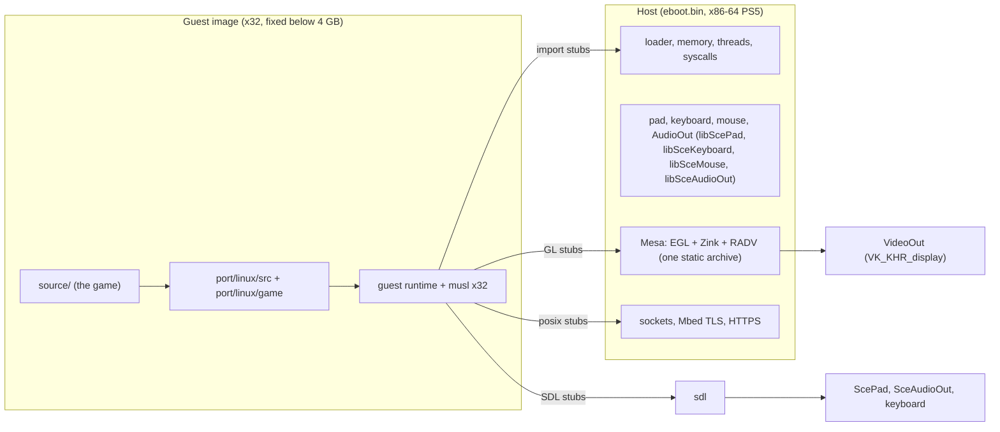

# OpenCE on the PlayStation 5: port plan

Status: M0's gate passed. Written 2026-10-31 against OpenCE `da8d4556`.
On the console (.41, `port/ps5/FINDINGS.md`): S1-S4 pass (run2), S5a
(run6: OpenGL ES 3.2 on Zink on RADV in a plain title) and S5b (run11-13:
Zink presenting itself on VideoOut at 119.88 Hz, at 3840x2160, 2560x1440
and 1920x1080) pass; S7 and S8 pass (run16: sockets, `/data/opence`, the
maps read in place from the disc image); S6's automatic checks pass
(run17: pad, keyboard, mouse and AudioOut beside Zink at 120 fps), its
hands-on checks wait for a person at the console. Every other claim about
the PS5 below cites the repository that measured it.

## Summary

OpenCE becomes a native PS5 title (`ninja ps5`), not a Wine application.
The design is the Android port's, moved from AArch64 to x86-64:

- **Guest**: the game, the platform layer and a small runtime, compiled as
  **x32** code (`--target=x86_64-linux-gnux32`: 64-bit x86 instructions,
  32-bit `int`, `long` and pointers). It is linked to a static image below
  the fixed addresses the game's data requires (the image at `0x7c000000`,
  the Xbox memory at `0x80000000`).
- **Host**: a 64-bit PS5 title built with the PS5 Payload SDK. It reserves
  the guest's addresses below 4 GB, loads the image, and performs every
  call the guest cannot make itself: system calls, SDL (input, audio,
  events), OpenGL, sockets, DTLS, HTTPS.
- **Graphics**: the existing OpenGL renderer (`d3d8_gl.c`) on **Zink**
  (Mesa's OpenGL on Vulkan) on the PS5 **RADV** driver, both from
  `../forever/PS5_Mesa`, built together into one static archive and
  presented through RADV's VideoOut WSI (`VK_KHR_display`).

The pieces taken from `../forever`:

|OpenCE needs|Comes from `../forever`|State there|
|---|---|---|
|Compiler, linker, libc, libc++, Sony library stubs, `libps5platform.a`, klog|`PS5_PayloadSDK` (`prospero-clang`, target `x86_64-sie-ps5`)|Used by every Forever title|
|Vulkan driver|`PS5_Mesa` RADV, `radv-winsys=ps5`, with `ps5-proton/ps5-wow/ps5/radv/patches/0001-0003`|Shipped in Forever Launcher 01.000.021|
|OpenGL|`PS5_Mesa` Zink (same tree, Mesa 26.2.0)|Rendered PokeMMO through WGL under Wine on RADV (OpenGL 4.6); never built native|
|Presentation|`PS5_Mesa/src/vulkan/wsi/wsi_common_videoout.c` (`VK_KHR_display`, 3840x2160 at 59.94 Hz, 119.88 Hz with title metadata)|Shipped|
|Pad, keyboard, mouse, audio|`libScePad`, `libSceKeyboard`, `libSceMouse`, `libSceAudioOut`, called as SavageWindRecomp's `runtime/ps5/input.c` and `audio.c` call them (D6)|Run in Savage Wind on .41; here, S6 run17|
|Mbed TLS (DTLS for internet play), zlib|`pacbrew-repo/mbedtls`, `pacbrew-repo/zlib`|Packaged|
|Title packaging, signing, deploy, launch, logs|`PS5_Vulkan/tools/` (`deploy-title-folder.py`, `run-title.py`, `ps5_console.py`: FTP 2121, klog 3232, control 9111); `make_fself`/`self --sign` as in SavageWindRecomp `ps5/tools/build-title.sh:121-142`|Used by every native title|
|VRR/high frame rate metadata|`attribute3` with `0x40040` set and `0x80000` clear (`ps5-wow/ps5/title/build.sh:178-184`)|Qualified in 01.000.021|

`../forever`, `../PS5_Vulkan` and `../PS5_Mesa` are read-only for this
port. Changes OpenCE needs in Mesa are kept as patches in this
repository and applied to pinned exports (as `ps5-wow/ps5/radv/patches` and
SavageWindRecomp `ps5/patches` do).

## Is this a Wine port?

No. The Forever stack does run 32-bit Windows programs (its Wine builds
`--enable-archs=i386,x86_64`, `ps5-wow/ps5/build-wine.sh:127-128`, and a PE32
probe passed SEH, threads, fibers and win32k: `ps5-wow/ps5/probes/psmkit-wine/protocol.h:60-62`),
so running OpenCE's Windows build under Wine was considered and rejected:

- OpenCE already has a 64-bit host and 32-bit guest design that works
  (Android). Moving it to x86-64 reuses OpenCE's own loader, stubs, generators
  and source changes. A Wine port would ship a second operating system for
  one program.
- Under Wine the game, a 32-bit Mesa WGL/Zink and Wine's WoW64 Vulkan
  thunks would all share one 4 GB address space that must also keep
  `0x80000000`-`0x88000000` free for the Xbox memory. None of that is
  tested on the PS5; PokeMMO's Zink is 64-bit.
- Every OpenGL call would cross Wine's WoW64 thunks, and the Forever
  title's process model (PsmKit children, write broker, dual parents)
  exists for Battle.net and WoW, not for this game.

Every route, Wine included, needs `0x80000000`-`0x88000000` free in the
game's process, so M0's first probe (S1) decides all of them. Wine stays the
fallback only if a native title cannot execute code it loads (S2), since
Forever's Wine runtime already does.

## Goals

1. `python configure.py --ps5` and `ninja ps5` build a title folder
   (`build/ps5/PPSA99117/`: `eboot.bin`, `sce_module/libc.prx`,
   `sce_sys/param.json`, `sce_sys/icon0.png`) from this repository, with
   pinned dependencies.
2. The campaign, split screen and system link play on a PS5 with a
   DualSense, at the TV's resolution, at 60 frames per second or better.
3. Internet play, the server browser and map sharing work as on the other
   ports, with machines of the same `HALO_PORT_NETWORK_VERSION`.
4. Custom Edition maps and mods load from the data folder, as on Linux.
5. The guest image the title runs can also run under a Linux x86-64 host,
   so that the existing tests (harness, stagekit, `net_compare.py`) check
   the PS5 guest without a console.

## Not goals

- A Vulkan or AGC renderer. The renderer stays `d3d8_gl.c`.
- Shipping game data. The user copies their own `maps/` (as for every port).
- HDR, frame generation (unless M6 calls for it, D12), PS5 trophies,
  activities, the PS5 on-screen keyboard (the game's own on-screen keyboard
  works with the pad; a USB keyboard types).
- Changing `../forever` or the Forever Launcher title.
- A 64-bit (LP64) build of the game: the cache files and saved games hold
  32-bit pointers (`port/android/README.md:335-344`).

## Baseline

|Repository|Commit|
|---|---|
|OpenCE|`da8d4556` (2026-10-30)|
|`../forever/PS5_PayloadSDK`|`fdb2763789a50a4fcc9a98dcae13f5e336c6a1ee` (same as `WORKSPACE.json` `sdk_commit`), over the upstream v0.42 binary SDK (`../forever/.downloads/ps5-payload-sdk.zip`)|
|`../PS5_Mesa`|`1ba9874f478657ccf6da72ce55f0260164cc0bd0` on `main` (Mesa 26.2.0; the revision `../PS5_Vulkan`'s `tools/build-radv.sh` pins). `origin/main` `a8800d9` adds three Zink/WGL fixes. Branch `feat/videoout-hdr10-vrr` `b260481` (pushed to `bizkut/PS5_Mesa`) merges `feat/videoout-hdr10` `3907ff7` (HDR10 output, upstream PR #6) and `fix/videoout-vrr-idle-floor` `f67ce2e` (upstream PR #5); its commit message records a console run with HDR10 PQ and 119.88 Hz VRR at once. Forever's `../forever/PS5_Mesa` `f10c4ba` (export of `15a5e9933e14`, PokeMMO's qualified Zink) is the reference if Zink behaves differently|
|`../forever/ps5-proton/ps5-wow`|`bdb6e38` (`ps5/radv/patches/0001-0003`, title helpers for reference)|
|`../PS5_Vulkan`|`f410e67a0241b3e8edcdbcd2a9b285dfc4a412ed` on `main` (title tooling, deploy and run tools; its tooling is identical to `9442a16`, which run2 used and which a rebase left on no branch; its own SDK pin `b83202be` is older than the one above and not used). Branch `feat/videoout-hdr10` `c9704ea` holds the HDR10 console runs|
|`../forever/pacbrew-repo`|`2e3eaf9c5fda03535d0b5e5c3f807a38acdac452` (mbedtls, zlib recipes)|
|Docker image for the Mesa build|`forever-launcher-linux:ubuntu-24.04` (`daab52de3af4`, cached on this machine; reuse, never rebuild)|

The pins go into `port/ps5/deps.lock`; `tools/ps5_deps.py` exports each
commit with `git archive` (never builds in the shared worktrees) into
`build/ps5/deps/`, checks SHA-256 of the archives it downloads, and records
what it built.

Title ID: **PPSA99117**, free in `../forever/catalog-submission/apps/` and
in every local `sce_sys/param.json` on 2026-10-31. Check again before the
first install.

### The reference port

`../SavageWindRecomp` (branch `ps5`, title PPSA90212) is a working native
PS5 game port on the same libraries, and the reference for this one (the
owner's direction, 2026-10-31): where it measured something, this plan uses
its result; where it solved something, this port does it the same way unless
a finding here says otherwise. Already taken from it: the title's link
recipe (`ps5/tools/link-recipe.sh`), the fixed guest memory through
`sceKernelReserveVirtualRange` and direct memory, the data folder under
`/data` with ShadowMountPlus, `param.json`'s `attribute3`, the evidence and
`FINDINGS.md` records, and its measurements of FSR 4, FSR 1 and frame
generation (D12). Still to take: its storage and paths layer
(`runtime/platform/paths_ps5.c`, `runtime/storage_ps5.c`), reading game data
in place (D7), its pad, keyboard, mouse and audio backends (D6,
`runtime/ps5/`), its benchmark method (M6), and its native-4K
captures for comparing pictures.

## Architecture

### Decisions

**D1. The guest is x32 code.** The game must be ILP32
(`port/linux/include/halo_linux_prefix.h:13-15`). The PS5 SDK has no 32-bit
target (`prospero-clang` is `x86_64-sie-ps5`, the linker script
`elf64-x86-64`). x32 is the x86-64 equivalent of Android's `arm64_32`:

- clang 18 emits it directly as ELF (`ELF 32-bit LSB relocatable, x86-64`):
  no Mach-O detour, so `tools/android_asm_convert.py` has no counterpart.
- The x32 and x86-64 SysV conventions put integers, pointers and floats in
  the same registers, the property the Android stubs rely on
  (`port/android/README.md:389-390`). A union of `long` and `float` comes
  back in `eax`, as the game's `long`-typed calls expect.
- Struct layout matched the i386 build's `-malign-double` layout for one
  test struct on 2026-10-31 (`char`, `double`, `long long`, pointer, `long`:
  32 bytes, the same offsets under both targets). One struct proves
  nothing for the game's types: M1 adds `tools/guest_layout_check.py`,
  which compares the size, alignment and member offsets of every struct and
  union in the DWARF of the i386 Linux objects and the x32 guest objects,
  and fails on any difference. `tools/android_abi_check.py`, extended to
  x32, checks declarations against definitions.
- musl has an upstream `x32` architecture; the guest libc takes it as
  Android's took `arm64_32`, with system calls sent to the host.
- x32 code follows the x86-64 small code model: every symbol lies below
  2 GB. An indexed access to a global is an `addr32` instruction with a
  sign-extended displacement (`R_X86_64_32S`), and ld.lld refuses both
  that and the image's debug information when the image is linked at
  `0x88000000`, where Android's is (checked 2026-10-31, clang/lld 18). The
  x32 image therefore sits right below the Xbox memory, at `0x7c000000`
  (D4). Only the window's address is fixed by the game's data; the image's
  is the port's choice.

The alternative, **i386 code in compatibility mode**, is possible on this
kernel: ps5-wine's WoW64 enters 32-bit mode through the GDT's 32-bit user
code segment, selector `0x33`
(`ps5-wine/dlls/ntdll/unix/signal_x86_64.c:4034-4038`). It would run the
exact code of the Linux build, but every host call would be a far
transition (thousands per frame for OpenGL), the `%fs`/`%gs` handling is the
kernel-specific part Wine works around, and no non-Wine program has used it.
It is the fallback only if x32 hits a blocker in M1.

**D2. The guest's thread-local variables use emulated TLS.** x32 TLS
addresses `%fs`, which the host's libkernel owns. The guest compiles with
`-femulated-tls`; `__emutls_get_address` and musl's `__pthread_self` read
the guest thread pointer through `host_get_tp`, as the Android guest does
(`port/android/host_imports.list:7-8`). Users: `__thread` in
`cseries.c:362`, `msvc_wide.c:185`, `posix_net.c:78,341`,
`xbox_kernel.c:62,174`, `xnet.c:328`, `profile_trace.c:118`.

**D3. The host loads the image at run time into memory it maps
executable.** A title cannot `dlopen` or `sceKernelLoadStartModule` its own
modules (SavageWindRecomp `ps5/FINDINGS.md:8-11`), and an ELF32 image cannot
be linked into the ELF64 eboot. Forever's Wine runtime loads its ELF modules
itself: direct memory mapped read-write, then `mprotect` with `PROT_EXEC`
(`ps5-wow/ps5/probes/psmkit-wine/elf-runtime.c:337-359,630-633`). The PS5
loader (`port/ps5/host/host_loader.c`) follows that and
`port/android/host/host_loader.c`. The image ships in the title folder
(`/app0/halo_guest.elf`); its SHA-256 is checked before mapping.

**D4. Guest memory is reserved with the kernel's own calls.** Anonymous
`mmap` of large fixed ranges fails on the PS5; `sceKernelReserveVirtualRange`
plus fixed `sceKernelAllocateDirectMemory`/`sceKernelMapDirectMemory`
works, and pages are 16 KiB (SavageWindRecomp `ps5/FINDINGS.md:13-27`).
`port/ps5/host/host_memory.c` keeps the Android pool logic
(`port/android/host/host_memory.c:503-751`) and replaces `reserve()` and the
`/proc` scans, which the PS5 lacks.

Proposed address map (M0 confirms or moves the pools):

|Range|Use|
|---|---|
|`0x00400000`-…|the eboot (system loader; vkQuake's measured base)|
|below `0x7c000000`, as free|guest pools: heap, guest thread stacks|
|`0x7c000000`-`0x80000000`|guest image (64 MiB room; below 2 GB, D1)|
|`0x80000000`-`0x80118000`|the title's `sce_module/libc.prx`, mapped there by the console's loader before `main` (run1, run2); the window's allocator treats these pages as taken|
|`0x80120000`-`0x88000000`|Xbox contiguous memory (`platform.h:150`, `halo_android_abi.h:36-37`), from the first 64 KiB boundary above `libc.prx`; the game's fixed addresses start at `0x803A6000`|
|`0x88000000`-`0xffffffff`, as free|guest pools|
|`0x200000000`-`0x300000000`|left free for RADV's BO window (SavageWindRecomp `ps5/FINDINGS.md:435-440`)|

**D5. OpenGL is Zink on RADV, built as one Mesa.** Zink, EGL and RADV come
from one Meson build of `../PS5_Mesa`'s `feat/videoout-hdr10-vrr` (HDR10
and the VRR idle floor already in it), so NIR, the Vulkan runtime and Mesa's
utilities are compiled once. `tools/ps5_mesa.py` builds it into three
archives (`libvulkan_radeon.a`, linked whole, `libgallium.a`, `libEGL.a`),
with OpenCE's patches (`port/ps5/patches/mesa/`):

1. `0001`: EGL and libgallium as archives on the PS5, and the DRI frontend
   turned on for Zink without DRM, as on macOS.
2. `0002`: Zink takes `vk_icdGetInstanceProcAddr` and
   `vk_common_GetDeviceProcAddr` from the linked RADV instead of
   `util_dl_open("libvulkan.so.1")`.
3. `0003`: the DRI2 frontend without libdrm; no System V shared memory.
4. `0004`: EGL's surfaceless platform goes on to Zink without a DRM device.
5. `0005`: a window surface on the surfaceless platform is the one
   display: Zink's kopper (`src/gallium/frontends/dri/kopper.c`) presents
   it through a `VK_KHR_display` surface on RADV's VideoOut WSI, on the
   display mode of the window's size. The native window is two `uint32_t`,
   the width and height, given to `eglCreatePlatformWindowSurface`. A
   display has one swapchain at a time and Zink destroys a window's late,
   so the game makes its window once, at its start.

S5a and S5b (`port/ps5/FINDINGS.md`) run pbuffers and windows through
these on the console.

The renderer runs its OpenGL ES 3.x path (`HALO_GLES`), which the Android
port already runs on Zink (Turnip, `port/android/README.md:453-459`) and
whose guest stubs exist (`tools/android_gl_stubs.py`). Zink also offers
desktop OpenGL 4.6; M6 measures both and keeps the faster.

Rejected: `pacbrew-repo/ps5-opengl` (prebuilt OpenGL 3.3 Core over AGC,
custom licence, cannot be combined with the AGPL; the desktop shaders need
GLSL 4.50), SDL3's OSMesa (software rendering), a new Vulkan renderer (out of
scope).

**D6. The pad, keyboards, mice and audio use the PS5's own libraries, as
Savage Wind does.** pacbrew's SDL3 input port drops short pad transitions
(it reads `scePadReadState`), has no keyboard or mouse, and no motion data
(SavageWindRecomp `docs/PS5-PORT-PLAN.md:217-222`, citing
`SDL3-input/PORT_STATUS.md:30-39`), so Savage Wind wrote its own backends
(`runtime/ps5/input.c`, `audio.c`), which run on .41 (its
`ps5/FINDINGS.md:477-501,521-554`). The host implements the `host_sdl_*`
imports the guest's SDL calls cross (`port/android/host_imports.list:17-53`)
on them: `scePadRead` drained every poll (64 records, oldest first), in
SDL's DualSense button and axis numbering; `sceKeyboardRead` and
`sceMouseRead` for indexes 0 and 1; one `SceAudioOut` main port (48 kHz
stereo S16, 256-frame periods) fed by one worker that runs the guest's
audio callback; window and GL calls go to EGL (D5). OpenCE adds what Savage
Wind does not need: a pad for each signed-in user, for split screen. No SDL
library is linked on the PS5, and the guest does not change. Code taken
from Savage Wind keeps its notice (GPL-3.0-or-later, which the AGPL
allows). S6 (run17) opened all of them beside Zink presenting at 120 fps.

**D7. Data lives in `/data/opence`.** `maps/`, `custom_maps/`, `mods/`,
`config.toml`, saved games and logs, as `paths.data` on Linux. Reading `/data`
from a title needs ShadowMountPlus (SavageWindRecomp
`docs/PS5-PORT-PLAN.md:281-295`); without it the title shows one message
saying so and exits. The player puts their disc image there (the owner's,
`Halo - Combat Evolved (USA) (Rev 2).xiso.iso`, 3.6 GB, is in
`/data/opence` on .41). The title reads the maps out of the image in place,
as Savage Wind reads its packages (`docs/PS5-PORT-PLAN.md:145-149` there),
rather than copying them as `port/linux/src/xiso.c` does: the maps are
1.8 GB, and title writes slow from about 2 GiB written
(SavageWindRecomp `ps5/FINDINGS.md:104-116`). The game's own writes (saved
games, settings) are small and go direct, so no write broker.

**D8. Networking goes through the host's sockets.** The guest's
`posix_net.c`, `posix_dtls.c` and `posix_upnp.c` are called through the
generated posix stubs, as on Android (`port/android/README.md:384-393`); DTLS
uses Mbed TLS from pacbrew; HTTPS (`host_https_get`) uses Mbed TLS too.
S7 (run16): a title binds UDP and TCP port 2302, receives and answers
datagrams and connections from another machine, broadcasts and receives its
own broadcast, and connects to the internet. Name lookups go to libSceNet's
resolver (`sceNetResolverStartNtoa`, 0.2 s for a first lookup): libc's
`getaddrinfo` is the platform layer's refusal in a title link. Whether
another machine on the console's LAN receives its broadcasts is not
measured yet (no machine of this project is on that LAN; M8 needs one).

**D9. The PS5 build plays with the others only if its simulation agrees.**
The guest is compiled with `-ffp-contract=off` and the vendored musl maths,
as every port. Checked on 2026-10-31 with clang 18: the i386 build does
scalar `float`/`double` arithmetic in SSE2 (`mulsd`, `addsd`, `divss`, or
their VEX forms) because `march_flag()` always passes `-march=native` or
`-march=x86-64` (`tools/linux_build.py:265-270`, also used by
`tools/windows_build.py:357`); without a `-march` it would use x87
(`fmull`, `faddl`). Its results still pass through x87 `st(0)` on return
(`fldl`), which keeps every value but quiets signalling NaNs. The x32 guest
uses SSE2 throughout. The guest pins `-march=x86-64-v3` (the PS5's Zen 2
has it; `-ffp-contract=off` keeps FMA out). M1 checks the guest image for
x87 instructions outside `long double` code, and `tools/net_compare.py`
decides (M1 under Linux, M8 on the console).
`HALO_PORT_NETWORK_VERSION` changes only if the wire format changes.

**D10. The same guest image runs on Linux.** `ninja ps5_linux_host` builds
`build/ps5/halo_guest.elf` and a Linux x86-64 host (`port/ps5/host` with
`port/ps5/host/linux/` for memory and the window: SDL3 and desktop Mesa). CI
and the existing tests then exercise the PS5 guest, its stubs and its ABI
without a console. The console runs only what Linux cannot show: the PS5
kernel, Zink on RADV, VideoOut, the pad, AudioOut, the network.

**D11. 3840x2160 if the game holds 120 frames a second there.** (The
owner's decision, 2026-10-31.) VideoOut takes buffers of 3840x2160,
2560x1440 and 1920x1080, each at 59.94 Hz or, with the title's
high-frame-rate metadata, 119.88 Hz, and scales each to what the screen
takes (`../PS5_Mesa` `src/vulkan/wsi/wsi_common_videoout.c:11-18`); Zink's
window takes the mode of its size (patch 0005). The title cannot tell a
1080p TV from a 4K one: VideoOut reports 4K on both (SavageWindRecomp's
findings). The game draws at 3840x2160 and presents at 119.88 Hz if M6
shows it holds 120 frames a second there; otherwise the largest size that
does, 2560x1440 or 1920x1080. The other sizes stay a setting, like
`display.resolution` on the desktop, and the existing `display.anti_aliasing`
(`"smaa"`, `"ssaa2x"`) and `display.resolution_scaling` work as on every
port. What 4K adds to this game is sharper edges, HUD and text; its
textures do not gain detail: the Xbox drew 640x480, and of the 3,751
bitmaps in the owner's disc image the median's longer side is 128 texels,
88.5 % are 256 or less and 75 exceed 512 (`port/ps5/FINDINGS.md`). The
existing `display.anisotropic_filtering` and `display.model_detail =
"native"` are what sharpen surfaces and distant models at 4K.

**D12. Real frames first; an upscaler or frame generation only where M6
shows the need.** OpenCE already draws a real frame for each refresh,
interpolating the 30 game ticks a second (`display.interpolation`). For each
lever, what the reference port measured on .41 and what it would need here:

|Lever|Cost on the PS5|Needs from the renderer|Use here|
|---|---|---|---|
|Native 3840x2160|M6 measures it|nothing|the default if it holds 120 fps (D11)|
|Lower size, VideoOut scales (2560x1440, 1920x1080)|less GPU; S5b ran both at 119.88 Hz|nothing|the first fallback, a setting|
|FSR 1 (EASU + RCAS) on the 3D view, HUD at full size|a pass; Savage Wind's 4K output default before FSR 3.1 (`runtime/nvn/output_scale.c`)|nothing|if the GPU limits at 4K: better than VideoOut's scaling at the same cost|
|FSR 4 (`../ps5-fsr4`)|on RADV 3.8 ms for 1280x720 to 1920x1080, 14.3 ms for 1920x1080 to 3840x2160 (SavageWindRecomp `ps5/FINDINGS.md:1088-1103`)|linear colour, depth, motion vectors and jitter, as Vulkan images (`ps5-fsr4/docs/FSR4_SDK.md:73-119`); "No OpenGL backend"|never at 4K output: 14.3 ms is beyond 120 fps's 8.33 ms alone. At 1920x1080 output it fits (3.8 ms), as anti-aliasing better than native in ps5-fsr4's captures, but Halo's renderer has no motion vectors (Savage Wind needed a spike to reconstruct them, `docs/motion-vectors-spike.md` there) and Zink would have to share its images with FSR 4's compute. A later quality option, after M6, measured against SMAA|
|Frame generation, MihawkGen (`../PS5_MihawkGen`)|Savage Wind: 59.6 game fps presented at 119.3 fps; 1.6 to 2.75 ms per generated frame (`ps5/FINDINGS.md:744-761,903-921` there)|the 3D view without the HUD (OpenCE draws the HUD after it, `render/render.c`), colour only|only if the CPU cannot hold 120 real frames: it adds a frame of latency to a shooter, ghosts in fast motion (the owner saw it in Savage Wind), and stays off in menus|
|OptiScaler (`../OptiScaler`)|-|a PC game's own DLSS, FSR or XeSS calls in D3D11, D3D12 or Vulkan, which it redirects (its README)|not applicable: OpenCE draws OpenGL, and a PS5 title has nothing to inject into|

M6 records GPU and CPU time per frame, as Savage Wind's benchmarks do, so
that the lever matches the limit: a GPU limit takes the lower size or FSR 1,
a CPU limit (the game, Zink's command recording) frame generation.

### The guest/host boundary

The Android files are shared in place, not copied or moved (M1, built):

|Shared|How the x32 guest uses it|
|---|---|
|`port/android/guest/runtime/*`|compiled as they are; the image header's section and Android's render policy behind `HALO_X32_GUEST`/`HALO_ANDROID`|
|`port/android/guest/libc/arch/arm64_32` (musl 1.2.5 subset)|`port/ps5/guest/libc/arch/x32` holds only what x32 overrides (atomics, thread pointer, relocations, `alltypes`, `fenv`, `float`, `setjmp`, from musl's `arch/x32`, MIT); arm64_32's follows it in the include path, so both guests share one kernel interface (asm-generic system call numbers and structures) and one host dispatcher|
|`port/android/guest/guest.ld`|`port/ps5/guest/guest.ld`: the image at `0x7c000000`, at most 64 MiB, constructors from `.init_array`|
|`port/android/host/host_{loader,memory,thread,syscall,sdl,gl,debug,watch_hash,https}.c`|compiled as they are for the Linux host; ELF32 x32 images behind `HALO_X32_GUEST`, Android's own parts (ART, properties, log, toast) behind `__ANDROID__`, registers behind `__aarch64__`/`__x86_64__`; `port/ps5/host/linux/` adds `main.c`, the stat conversion and, generated, the asm-generic to x86-64 system call numbers|
|`port/android/host_imports.list`|the common imports; Android's own (`host_android_*`, `host_gesture_insets`, `host_touch_*`) moved to `port/android/android_imports.list`, which only Android's generator reads|
|`tools/android_imports.py`, `android_gl_stubs.py`, `android_posix_stubs.py`|an `--arch x32` mode each; Android's outputs byte-identical|
|`tools/android_build.py`'s guest graph|one `generate_guest_build` for both guests; `tools/ps5_build.py` gives it the x32 flags, `tools/ps5_host_build.py` builds the Linux host|

`HALO_GUEST` is the guest's ABI (ILP32 in a 64-bit process, its own musl,
SDL only through the host's imports); `HALO_ARM64_GUEST` and
`HALO_X32_GUEST` are the instruction sets (the Darwin `bss_seg` pragmas,
`msvc_crt.c`'s FPCR code and the BL call-site offset are AArch64's; x32
takes the x86 branches). The 128 MB window and the Xbox-sized caches follow
`HALO_ANDROID`: the x32 guest has the desktop's 512 MB window
(`0x80000000`-`0xA0000000`) and caches. An x86-64 frame record (saved
`rbp`, return address, 8 bytes each) has the AArch64 record's layout, so the
stack walk serves both under `HALO_GUEST`. Each change to `source/` keeps
its `port:` comment.

The x32 boundary:

- guest to host: `jmp *slot(%rip)` through an 8-byte import slot the loader
  fills. Clang's x32 callers zero-extend pointer arguments and its callees
  rely on it (a forwarding function compiles to a bare `jmp`), so the stubs
  pass registers through; only types whose width differs (`GLintptr`,
  `GLsizeiptr`, `GLsync`) go through the generated wrappers, as on Android;
- host to guest (the audio worker's callback, thread entry): the callback
  runs on a thread with a guest stack (`port/android/host/host_sdl.c`'s design);
- host pointers above 4 GB never reach the guest: mapped GL buffers are
  copied (`host_gl_buffer_write`, `host_gl_read_buffer`), as on Android;
- the guest's code paths that call desktop-only SDL (display modes,
  cursors, device lists, the updater, the dedicated server) take Android's
  path under `HALO_GUEST`; no `host_sdl_*` import was added, so the PS5 host
  implements exactly the list Android's does, less Android's own.

### Repository changes

|Path|Contents|
|---|---|
|`configure.py`|the `ps5_guest` and `ps5_linux_host` targets (built); `--ps5-sdk` and the `ps5` title target in M2|
|`tools/ps5_build.py`, `tools/ps5_host_build.py`|the x32 guest's graph (through `tools/android_build.py`'s `generate_guest_build`) and the Linux host's: `build/ps5/halo_guest.elf`, `build/ps5/linux/halo-x32` with the image linked in and `libSDL3.so.0` beside it, as the desktop build's; the title's eboot, SELF and folder in M2|
|`tools/ps5_deps.py`, `port/ps5/deps.lock`|pinned exports and builds: SDK, Mesa (in the cached Docker image), Mbed TLS, zlib|
|`port/ps5/host/`|`linux/` (built); the PS5's own beside it: start, paths, splash, exit, memory, EGL window, `host_ps5_input.c`, `host_ps5_audio.c` (D6)|
|`port/ps5/patches/mesa/`|patches over the pinned Mesa export|
|`port/ps5/sce_sys/`|`param.json` (PPSA99117, `attribute3` `0x40040`), `icon0.png` from the title art (`tools/title_assets.py`)|
|`port/ps5/README.md`|the PS5 build, installation, the data folder, settings, finding problems (in the style of `port/android/README.md`)|
|`tools/test_ps5_build.py`|the graph and the image (no console)|
|`.github/workflows/`|the PS5 build and the Linux-host tests; console runs stay manual|

## Milestones

Each milestone ends with a gate. M0 can stop the port; later failures move
work, not the design. Console runs go to the development console,
**10.0.1.41** (`PS5_HOST=10.0.1.41`; original PS5 on a 4K 120 Hz TV), and
use `../PS5_Vulkan/tools/` and
store their klogs and fetched files under `build/ps5/evidence/<milestone>/runN`
(local, not committed); measured facts go into `port/ps5/FINDINGS.md` with
run numbers. `python tools/ps5_probe.py ps5` builds the M0 probe title,
`python tools/ps5_probe.py linux --run` runs the same probe on Linux
(`PROBE_SIMULATE_LOADER=1` adds a stand-in for the console's `libc.prx`).

### M0. Feasibility probes on the console

Small probe titles (`port/ps5/probe/`), each answering one question:

|Probe|Question|Passes when|
|---|---|---|
|S1|Can a title reserve `0x7c000000`-`0x88000000` (the image's room and the Xbox memory, around what the loader already put there) and 512 MiB more below 4 GB, and back it with direct memory?|nothing mapped in a range before it is reserved; the window free from below `0x803A6000`; `sceKernelReserveVirtualRange` at the exact addresses, read and write of every page; the loader's mappings unchanged; the title's map below 4 GB is logged|
|S2|Can it execute x32 code it loaded there?|an x32 image at `0x7c000000` (made executable after loading) calls host functions through stubs and returns the right sum of int, pointer, float and `long long` arguments, and computes `probe_work` bit for bit as x86-64 code does|
|S3|Do guest threads run on stacks below 4 GB?|8 threads with `pthread_attr_setstack` stacks in the low pools run x32 code for 60 s|
|S4|Do write faults reach the host's handler?|a `PROT_READ` page in the window is written, `SIGSEGV`/`SIGBUS` handler unprotects it, the write completes (the memory watch); otherwise the hash fallback (`host_memory_watch_use_hashes`) is the PS5 default|
|S5a|Zink on RADV, native, without a window|Zink built with the patch that takes `vkGetInstanceProcAddr` from the linked RADV; an EGL surfaceless pbuffer context reports Zink and RADV, draws, and its `glReadPixels` result, copied into a RADV `VK_KHR_display` swapchain image, shows on the TV for 300 frames; run with S1's reservations in place (guest window below 4 GB, RADV's `0x200000000` window untouched)|
|S5b|Zink presenting itself|the PS5 EGL window surface (kopper over `VK_KHR_display`) presents 300 frames at 3840x2160 with no readback|
|S6|The PS5's input and audio libraries beside Zink|while S5b presents: the signed-in user's pad opened and read, keyboards and mice opened and read, a 440 Hz tone through one AudioOut port at 48 kHz with no late period, no VideoOut error; with a person at the console: DualSense buttons and sticks, a USB keyboard's keys, the tone heard|
|S7|Sockets from a title|UDP and TCP on 2302 to and from another machine, a broadcast sent and received, a name resolved, TCP and UDP to the internet (DTLS itself in M8, with Mbed TLS)|
|S8|`/data/opence`|with ShadowMountPlus: create, write, rename, read back; the disc image's maps read in place, identical to the same files read on Linux; without ShadowMountPlus: the error is what D7 shows|

Order: S1, S2 and S3 first, before any Mesa build work; then S5a,
S5b, S6; the rest in any order.

Gate: S1, S2, S3, S5a pass. If S1 fails, stop and report: no route works
without those addresses. If S2 fails, the alternative is running the image
inside Forever's Wine runtime process, where loaded code executes. If S5b
is not done by then, M3 starts on S5a's readback presentation and S5b
continues beside it. S4, S6, S7 and S8 failures take the fallbacks named in
D4, D6, D8, D7.

### M1. The guest builds, and runs under Linux

- Split `HALO_ARM64_GUEST` (above); Android's code unchanged: shown by
  preprocessing every changed file with Android's defines and by Android's
  `build.ninja` text and generator outputs, since this machine has no NDK
  (`ninja android` and its tests run where one is).
- musl x32 with host system calls; guest runtime for x32; x32 stub emitters.
- `ninja ps5_linux_host`: the Linux host loads `halo_guest.elf` and plays.

Done when: `tools/harness`, `tools/stagekit/tests` and
`tools/test_linux_port.py` pass against the Linux-hosted x32 guest;
`tools/android_abi_check.py` (x32) and `tools/guest_layout_check.py`
report no mismatches; the guest image has no x87 instruction outside
`long double` code; a Linux-hosted x32 game and `build/linux/halo` finish a
system link game in `net_compare.py` without divergence.

Status (2026-10-31, `port/ps5/FINDINGS.md`): built and run. The game plays
under the Linux host (main menu, a hosted game on bloodgulch); the x32 and
i386 builds play bloodgulch in step in `net_compare.py`, each hosting;
`tools/stagekit/tests` pass with `HALO_GAME=build/ps5/linux/halo-x32`; the
x87 instructions are in 17 musl functions (long double, `fenv`, `printf`,
`strtod`), none in the game's; the boundary structures' layouts match
arm64_32's (compared by hand); `tools/android_abi_check.py` finds no unsafe
declaration in the x32 IR. Left: `tools/harness` against x32 (this kernel
runs no x32 programs, so its engine functions would be built as guest
images and run with `halo-x32 --image`), and `tools/guest_layout_check.py`
in place of the hand comparison.

### M2. Title shell

`eboot.bin` signed, folder installed with `deploy-title-folder.py`,
launched with `run-title.py`.

Done when: three consecutive runs log the build identity, reserve the
guest memory, load and verify the image, reach the game's `main` and exit
through `sceSystemServiceLoadExec("exit", NULL)`, with no `signal` in the
klog.

### M3. First frames

EGL/Zink context from the host; the guest's OpenGL ES calls through the
stubs; `sceSystemServiceHideSplashScreen` after the first presented frame.

Done when: the main menu draws at the display's resolution, and a frame
saved with `debug.screenshot_directory`/`debug.screenshot_every` matches the
Linux build's frame of the same menu at the same resolution; the per-pixel
difference is recorded in `port/ps5/FINDINGS.md`.

### M4. Input and audio

DualSense through the native backend (D6) to `xinput_sdl.c` (a pad for each
signed-in user, four for split screen), USB keyboard and mouse, rumble; audio
at 48 kHz stereo through `dsound_sdl.c`.

Done when: with the DualSense, a person moves, fires, drives and navigates
every settings screen, and four pads play split screen; ten minutes of the
first level pass with no AudioOut underrun in the klog; rumble is felt.

### M5. Data, settings, saved games, Custom Edition, mods

Done when: `config.toml` changes persist across restarts; a checkpoint
saves and loads; a Custom Edition map from `custom_maps` and a mod from
`mods` load; a missing or incomplete `maps/` folder shows the message the
Linux build shows.

### M6. Performance

Measure with `HALO_PROFILE` builds (`--profile`) on the console, the way
Savage Wind's built-in benchmark does (SavageWindRecomp `runtime/benchmark.c`,
set up by `benchmark.txt` in the data root, `docs/PS5-PORT-PLAN.md` M6 there:
a route with no player, frames on time, mean, p95 and p99, GPU and CPU time
per frame).

Done when: at 3840x2160, 2560x1440 and 1920x1080, a scripted route through
`a10`, `b30` and `d40` is measured over ten minutes for the share of frames
within 8.34 ms (120 frames a second) and within 16.7 ms, and for GPU and
CPU time per frame; the largest size with at least 95 % of frames within
8.34 ms becomes the default (D11); if none holds it, the limit found
chooses the lever (D12); OpenGL ES 3.x and desktop 4.6 on Zink are
compared and the faster is the default; the stub crossing count per frame
is recorded.

### M7. 120 Hz

`attribute3` already requests high frame rate (M2). Done when: the title
presents at 119.88 Hz on a 120 Hz TV with the frame rate setting raised,
and falls back to 59.94 Hz on a 60 Hz TV without a setting change. If M6
chose frame generation (D12): generated frames only in play, never in
menus; the HUD drawn over each generated frame from the newest real one;
the latency added measured against real 120 fps at a lower size.

### M8. Network

Done when: two PS5s, and a PS5 with a Linux machine, play a system link
game for ten minutes without divergence; a PS5 joins an internet game
hosted on Linux through the master servers; a map is shared from Linux to
the PS5. If the PS5 and Linux disagree, the PS5 plays only with PS5s and
the README says so; the cause is fixed or recorded before release.

### M9. Release

Done when: `port/ps5/README.md` and the settings table are complete;
`AGENTS.md` lists the PS5 build and its defines; CI builds `ninja ps5` and
runs the Linux-hosted guest tests; a release ZIP of `PPSA99117` installs
on a console without OpenCE's sources; a one-hour soak ends without a
signal or an error in the klog; the licences of the shipped binaries
(SDK runtime GPL 3.0, Mesa MIT, Mbed TLS Apache 2.0, Savage Wind's backends
GPL-3.0-or-later) are listed in the title folder.

## Testing

- Every change that the guest compiles is checked by `ninja android`,
  `ninja web`, `ninja linux` and `ninja ps5_linux_host`, plus the suites in
  `AGENTS.md` "Testing".
- New permanent tests only where a consumer could see a bug: the x32 stub
  emitter's argument handling (a host function receiving every argument
  kind), the image loader's checks (wrong magic, wrong ABI version,
  overlapping segments), the address map's reservation failure message.
- Console runs follow `ps5-native-title-probe-run`'s loop: console idle,
  deploy, run with a `--until` regex and a timeout, fetch the log, a new
  `runN` each time. Symbolise guest addresses with
  `llvm-symbolizer --obj=build/ps5/halo_guest.elf`, host addresses with the
  host ELF.

## Risks

|Risk|Effect|Mitigation|
|---|---|---|
|The PS5 reserves part of `0x80000000`-`0x88000000` in titles|No PS5 port by any route (the cache files fix these addresses)|S1 is the first probe, before any other work|
|Executable memory is refused for a title without Forever's setup|No image loading|S2 first; Forever's Wine runtime maps loaded code with `mprotect(PROT_EXEC)`, the probe checks the same in a plain title|
|Native Zink needs more Mesa work than the EGL platform|Late first frame|S5 before any game work; readback into a Vulkan swapchain as a stop-gap presentation|
|The native pad backend numbers buttons or axes differently from SDL's DualSense driver, which the desktop mappings assume|Wrong controls|Numbered as SDL's driver numbers them (SavageWindRecomp `runtime/ps5/input.c:144-155`); M4 checks every button and axis by hand|
|x32 ABI mismatches in the game's sources (prototypes, varargs)|Wrong values, rare crashes|`android_abi_check.py` for x32 in M1; Linux-hosted runs of the whole test suite|
|Direct memory pressure (RADV, Zink, the game share 12 GiB)|Allocation failures|The game needs well under 1 GiB; log `sceKernelAvailableDirectMemorySize` at start and each level|
|x32 floating point differs from the i386 build|No cross-play|`net_compare.py` in M1 under Linux, before any console time is spent on it|

## Not planned

Trophies, the PS5 Activity cards, PS5 cloud saves, HDR, a native AGC
renderer, a PKG release (the title folder is installed as other homebrew
titles are), and Bink movies (the game skips them on every port).

## Questions for the owner

1. Title ID `PPSA99117`: acceptable, or is there a registry of IDs to take
   it from?
2. Is ShadowMountPlus an acceptable prerequisite (D7), or must the game
   data live inside the title folder (`/data/homebrew/PPSA99117/`), which
   a reinstall replaces?
3. Is cross-play with the PC builds required for the first release (M8),
   or only PS5 with PS5?

Answered: the development console is 10.0.1.41 (2026-10-31).
